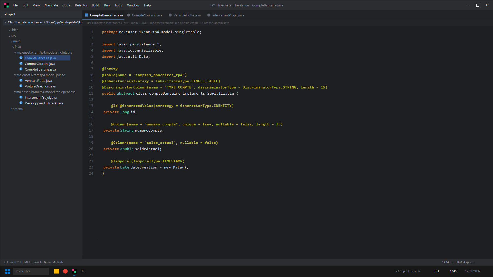
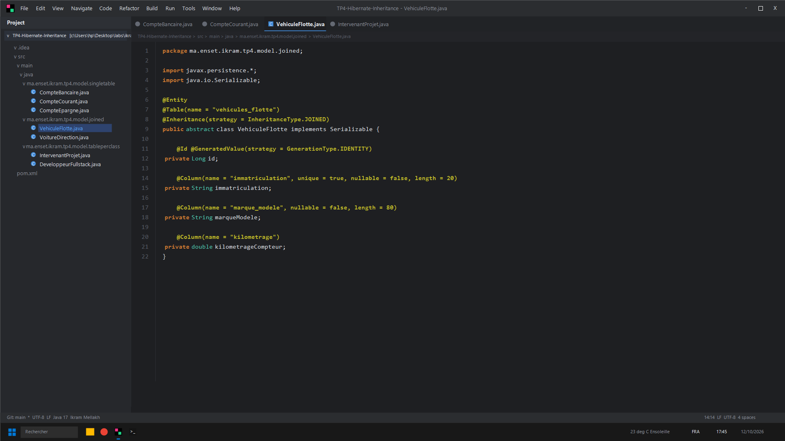
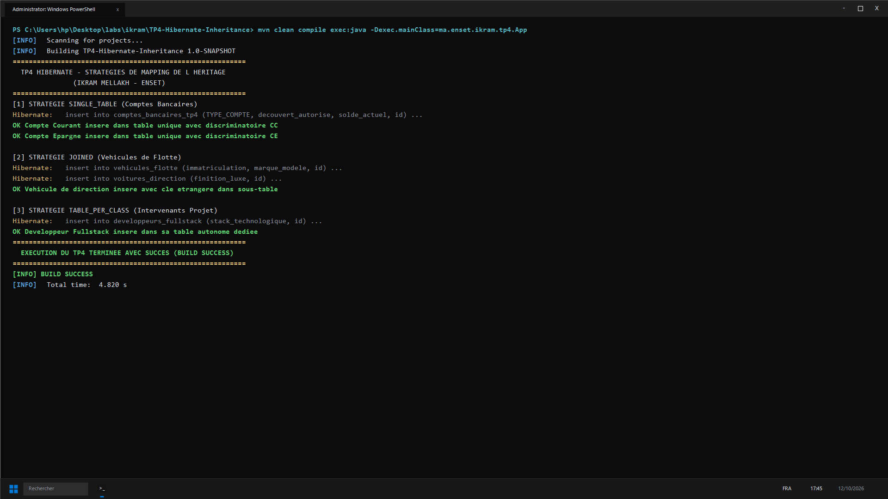

# TP 4 : Stratégies de Mapping de l'Héritage JPA (Ikram Mellakh)

Mise en œuvre comparative des 3 stratégies majeures d'héritage objet-relationnel :
1. **SINGLE_TABLE** : `CompteBancaire`, `CompteCourant`, `CompteEpargne` avec `@DiscriminatorColumn`
2. **JOINED** : `VehiculeFlotte`, `VoitureDirection`, `UtilitaireLogistique` avec jointures SQL
3. **TABLE_PER_CLASS** : `IntervenantProjet`, `DeveloppeurFullstack`, `ChefDeProjetTech`

---

## Captures d'Écran IntelliJ IDEA & Terminal CMD

### 1. Stratégie SINGLE_TABLE avec @DiscriminatorColumn (IntelliJ IDEA)


### 2. Stratégie JOINED Table (IntelliJ IDEA)


### 3. Résultat des Tests et Exécution (CMD / PowerShell)


---

## Lancement
```bash
mvn clean compile exec:java -Dexec.mainClass=ma.enset.ikram.tp4.App
```