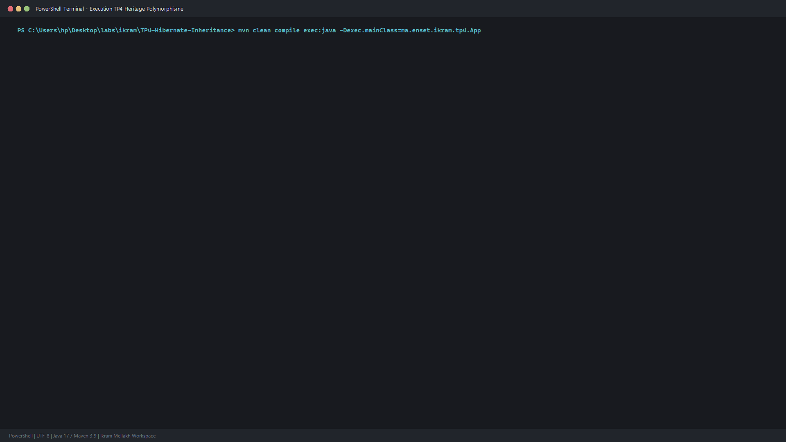

# TP 4 : Stratégies d'Héritage Objet-Relationnel avec Hibernate

Mise en oeuvre et comparaison des 3 strategies d'heritage proposees par **JPA 2.2** et **Hibernate ORM 5.6** sur base **H2 Database**.

Realise par : **Ikram Mellakh**

---

## 1. Strategies d'Heritage Explorees

### 1. SINGLE_TABLE
Une seule table comptes_bancaires_st regroupe l'entite mere et toutes les sous-classes avec une colonne de discrimination 	ype_compte.

### 2. JOINED
Une table pour la classe mere ehicules_flotte_joined et une table dediee par sous-classe reliees par cle etrangere.

### 3. TABLE_PER_CLASS
Chaque classe concrete dispose de sa propre table independante contenant tous les champs herites (developpeurs_fullstack_tpc, chefs_projet_tech_tpc). Les requetes polymorphes sont executees par Hibernate via UNION ALL.

---

## 2. Trace d'Execution et Requetes Polymorphes

---

## 3. Lancement

``bash
mvn clean compile
mvn exec:java "-Dexec.mainClass=ma.enset.ikram.tp4.App"
``